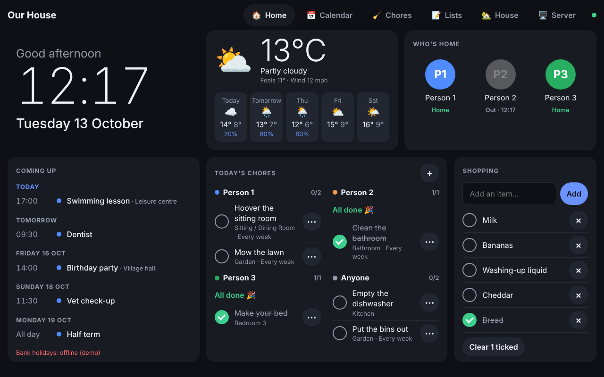
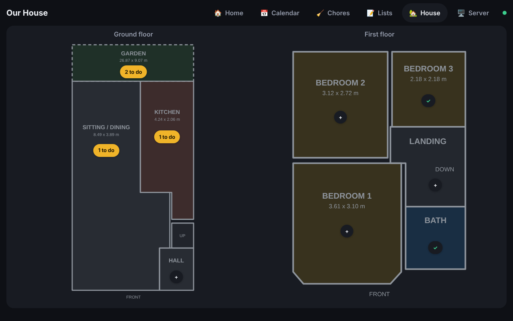

# Family Homepage

A self-hosted dashboard for the house: clock, weather, calendars, who's home, chores, shopping and to-do lists, meal plan, message board, bin days, a floor plan of the house, and server/Docker stats. It runs on its own (no Home Assistant), every screen updates live, and you can add any widget you like.



## Run it on the server (192.168.86.27)

You need Docker with the compose plugin.

```bash
git clone -b ccr-70269264-28l28e https://github.com/mjj04/hass-config-public-mj
cd hass-config-public-mj/homepage
docker compose up -d --build
```

Open **http://192.168.86.27:8080**. On first start it creates `config/homepage.yaml` with an example setup. Edit that file and the screens reload by themselves.

To update later: `git pull && docker compose up -d --build`.

Without Docker (Node 20+): `npm ci && npm start`. Docker stats then need `server.docker: unix:///var/run/docker.sock` and access to that socket.

## Put it on the wall tablet

- **Android:** [Fully Kiosk Browser](https://www.fully-kiosk.com/) pointed at the URL keeps the screen on and hides everything else. Chrome's "Add to Home screen" also opens it full screen.
- **iPad:** Safari > Share > Add to Home Screen, then Guided Access to lock it.

After `idle_return` seconds without a touch, the tablet goes back to the first page.

## Make it yours

Everything is in `config/homepage.yaml`:

| Section | What to set |
|---|---|
| `people` | Your family. `id` links chores to a person. `photo: /assets/name.jpg` uses a picture from `config/assets/`. |
| `rooms` | Room names for chores and the floor plan. |
| `weather` | Latitude and longitude of the house. |
| `calendars` | ICS links. For Google: Calendar settings > your calendar > *Secret address in iCal format*. UK bank holidays are already included. |
| `server` | Name and Docker connection for the Server page. |
| `pages` | Pages and the widgets on each one. |

Each page is a 12-column grid that is 8 rows tall on a landscape tablet. Every widget has a `type`, an optional `title`, and a size `w` (columns) by `h` (rows). On phones the cards stack.

### Built-in widgets

| type | Options |
|---|---|
| `clock` | `greeting`, `seconds` |
| `weather` | `days`, `hours` (0 hides either) |
| `calendar` | `days`, `calendars` (names to show) |
| `people` | Tap a person to switch them between Home and Out |
| `chores` | `person`, `room`, `anyone`. Daily chores reset each morning, weekly ones each Monday. Add and edit on screen. |
| `list` | `list` (any id: `shopping`, `todo`, `packing`…), `placeholder` |
| `meals` | `days`, `from` (`today` or `week`) |
| `note` | `note` (id), a shared message board |
| `floorplan` | `floors` with an image and room positions; badges show chores left per room |
| `system` | `show` (`host`, `docker`), `stopped` |
| `links` | `items` of `{ name, url, icon }` |
| `iframe` | `url`, `refresh` (seconds) |
| `bins` | `bins` of `{ name, color, next, every }`. This is the example custom widget in `config/widgets/bins.js`. |



## Add your own widget

Drop a file in `config/widgets/`. `config/widgets/countdown.js` becomes `type: countdown`:

```js
// el: the card body, opts: this widget's settings from homepage.yaml,
// ctx: helpers (below)
export default function countdown(el, opts, { h, fmt, every }) {
  const draw = () => {
    const days = Math.ceil((new Date(opts.date) - new Date()) / 864e5);
    el.replaceChildren(h('div', { style: { fontSize: '48px', fontWeight: 700 } }, `${days} days`),
                       h('div', { class: 'muted' }, `until ${opts.label}`));
  };
  draw();
  every(60_000, draw);
}
```

```yaml
      - { type: countdown, title: Holiday, date: 2026-12-20, label: Cornwall, w: 3, h: 2 }
```

The `ctx` helpers:

| | |
|---|---|
| `h(tag, attrs, ...children)` | Builds elements. Text is always escaped. |
| `api(path, { method, body })` | Calls the server and returns JSON. |
| `every(ms, fn)` | Repeats `fn` while the page is shown. |
| `on(topic, fn)` | Runs `fn` when another screen changes `lists`, `chores`, `people`, `meals` or `notes`. |
| `action(label, fn)` | Adds a button to the card header. |
| `dialog({ title, body, actions })` | Opens a pop-up. |
| `fmt` | `time`, `date`, `dayKey`, `dayLabel`, `since`, `bytes`, `duration` in the house's timezone. |
| `config`, `people`, `person(id)` | The public settings. |

A widget that needs data from the server or a private API key can have a server half, `config/widgets/<name>.server.js`:

```js
// GET /api/energy. config is the full homepage.yaml, including private keys.
export const routes = {
  'GET /api/energy': async ({ config }) => {
    const res = await fetch('https://api.example.com/usage', { headers: { Authorization: config.energy.key } });
    return res.json();
  },
};
```

Restart the container after adding a server file (`docker compose restart homepage`). Front-end files only need a page refresh. A file in `config/widgets/` with the same name as a built-in widget replaces it.

Only `title`, `locale`, `timezone`, `theme`, `idle_return`, `people`, `rooms` and `pages` are sent to the browser. Keep secrets in other sections.

## Data and backups

Lists, chores, meals, notes and who's home are saved in `data/db.json`. Back up `config/` and `data/`.

## Security

There is no login: anyone on your network can open the page and change the lists. Don't forward port 8080 on your router. For access from outside, use a VPN such as Tailscale or WireGuard.

The Server page reads Docker through `docker-socket-proxy`, which only allows read-only container requests. The homepage never gets the Docker socket itself.

## Development

```bash
npm ci
npm test     # starts the server against a temp config, a fake Docker API and a local .ics file
npm start    # http://localhost:8080
```
