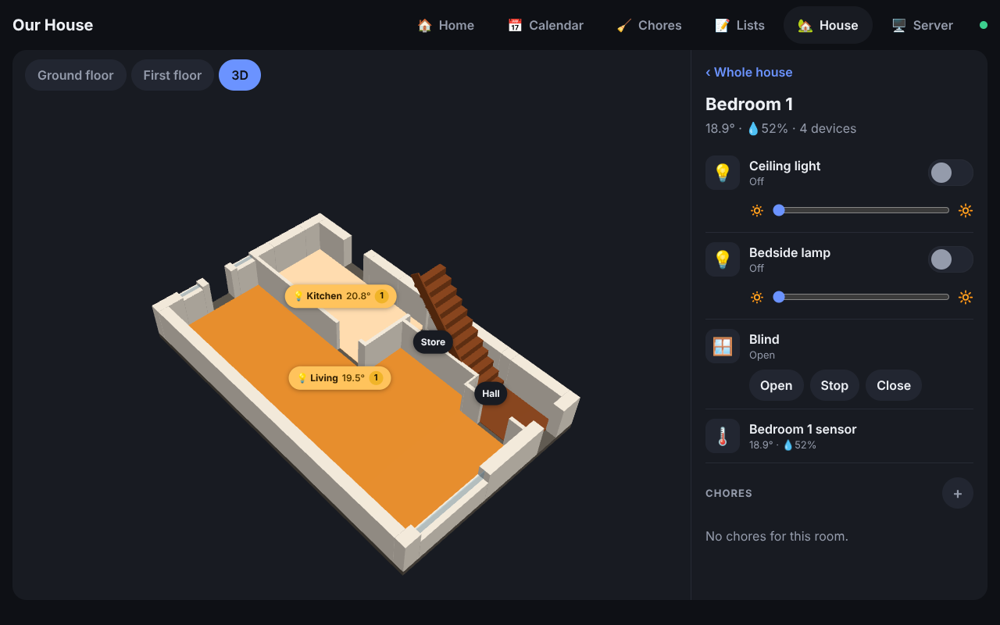

# Family Homepage

A self-hosted dashboard for the house: clock, weather, calendars, who's home, chores, shopping and to-do lists, meal plan, message board, bin days, an interactive plan and 3D model of the house with smart-device controls and scenes, and server/Docker stats. It runs on its own (no Home Assistant), every screen updates live, and you can add any widget or device connection you like.


## Run it on the server (192.168.86.27)

You need Docker with the compose plugin.

```bash
git clone -b ccr-70269264-28l28e https://github.com/mjj04/hass-config-public-mj
cd hass-config-public-mj/homepage
docker compose up -d --build
```

Open **http://192.168.86.27:9090**. On first start it creates `config/homepage.yaml` with an example setup. Edit that file and the screens reload by themselves.

To update later: `git pull && docker compose up -d --build`.

Without Docker (Node 20+): `npm ci && npm start`. Docker stats then need `server.docker: unix:///var/run/docker.sock` and access to that socket.

## Screens

- **4K TV or monitor:** open the URL in a full-screen browser (F11, or a kiosk mode). Big screens are scaled up automatically, so a 4K screen at 100% gets the same layout as a 1600 × 900 one, just sharper. To change it, set `scale:` in `homepage.yaml`, for example `scale: 2`, or `scale: 1` to turn scaling off.
- **Pixel and other Android phones:** open the URL in Chrome, then ⋮ > *Add to Home screen* > *Install*. It opens like an app, with the page tabs along the bottom.
- **Wall tablet:** [Fully Kiosk Browser](https://www.fully-kiosk.com/) keeps the screen on and hides everything else. On an iPad, use Safari > Share > Add to Home Screen, then Guided Access to lock it.

After `idle_return` seconds without a touch, the tablet goes back to the first page.

## Make it yours

Everything is in `config/homepage.yaml`:

| Section | What to set |
|---|---|
| `people` | Your family. `id` links chores to a person. `photo: /assets/name.jpg` uses a picture from `config/assets/`. |
| `rooms` | `{ id, name, short }`. `id` matches the room shapes in the house plans and model (`room_<id>`). |
| `devices`, `scenes` | Smart devices and one-tap scenes. See [Smart devices](#smart-devices). |
| `weather` | Latitude and longitude of the house. |
| `calendars` | ICS links. For Google: Calendar settings > your calendar > *Secret address in iCal format*. UK bank holidays are already included. |
| `server` | Name and Docker connection for the Server page. |
| `pages` | Pages and the widgets on each one. |

Each page is a 12-column grid that is 8 rows tall on a landscape tablet. Every widget has a `type`, an optional `title`, and a size `w` (columns) by `h` (rows). On phones the cards stack.

### Built-in widgets

| type | Options |
|---|---|
| `clock` | `greeting`, `seconds` |
| `weather` | `days`, `hours` (0 hides either) |
| `calendar` | `days`, `calendars` (names to show) |
| `people` | Tap a person to switch them between Home and Out |
| `chores` | `person`, `room`, `anyone`. Daily chores reset each morning, weekly ones each Monday. Add and edit on screen. |
| `list` | `list` (any id: `shopping`, `todo`, `packing`…), `placeholder` |
| `meals` | `days`, `from` (`today` or `week`) |
| `note` | `note` (id), a shared message board |
| `house` | `floors` of `{ name, plan }`, `model` of `{ obj, mtl, camera }`, `view`. See [The house](#the-house). |
| `devices` | `room`, `types`. Device controls grouped by room. |
| `scenes` | `scenes` (ids to show). Big scene buttons, plus All off. |
| `system` | `show` (`host`, `docker`), `stopped` |
| `links` | `items` of `{ name, url, icon }` |
| `iframe` | `url`, `refresh` (seconds) |
| `bins` | `bins` of `{ name, color, next, every }`. This is the example custom widget in `config/widgets/bins.js`. |

## The house

The House page shows your plans. Tap a room, on the plan or its label, to get its devices, temperature and chores in the side panel. Rooms with a light on glow, and the labels show the temperature and how many chores are left. **3D** opens the model: drag to turn it and tap a floor to pick that room.


The plans are SVGs whose room shapes have `id="room_<room id>"`. Your exports already do this, for example `room_kitchen` and `room_bedroom_1`. Any picture works under the shapes. The 3D model is an OBJ (+ MTL) whose floor meshes are named `room_<id>`. To use new exports, put them in `config/assets/` and point the widget at `/assets/...`:

```yaml
      - type: house
        floors:
          - { name: Ground floor, plan: /assets/ground.svg }
          - { name: First floor, plan: /assets/first.svg }
        model: { obj: /assets/house.obj, mtl: /assets/house.mtl, camera: [-1, 1.6, 1.1] }
```



## Smart devices

Each device in `devices:` has a `name`, a `room` (id or name), a `type` and a connection under `via:`. The `id` defaults to the name in snake case (`Floor lamp` becomes `floor_lamp`).

| type | Controls |
|---|---|
| `light` | On/off and brightness (`dimmable: false` hides the slider) |
| `switch`, `fan` | On/off, plus power use if reported |
| `climate` | Current temperature and a target you can nudge |
| `cover` | Open, stop, close |
| `sensor` | Temperature, humidity, power, battery |

| via | Works with | Example |
|---|---|---|
| `virtual` | Nothing physical: the state lives in the homepage. Handy for trying things out. | `via: virtual` |
| `zigbee2mqtt` | Any Zigbee device paired to Zigbee2MQTT (IKEA, Aqara, Hue bulbs without the bridge, TRVs…) | `via: { zigbee2mqtt: Kitchen ceiling }` |
| `tasmota` | Sonoff and other Tasmota plugs and switches | `via: { tasmota: sonoff_kettle }` |
| `mqtt` | Anything else on MQTT, including ESPHome | `via: { mqtt: { state_topic, command_topic, payload_on, payload_off } }` |
| `shelly` | Shelly relays and dimmers over local HTTP | `via: { shelly: 192.168.86.50, channel: 0 }` (`gen: 1` for older ones) |
| `hue` | Philips Hue bridge | `via: { hue: 3 }`, or `{ hue: 1, group: true }` for a Hue room |
| `wled` | WLED LED strips | `via: { wled: 192.168.86.60 }` |
| `http` | Any device with a web API | see below |
| `adapter` | Your own code in `config/devices/<name>.js` | `via: { adapter: myplug }` |

MQTT connections need the broker at the top level:

```yaml
mqtt:
  url: mqtt://192.168.86.27:1883
  username: homepage
  password: secret
  # zigbee2mqtt_base: zigbee2mqtt
hue:
  bridge: 192.168.86.x
  key: your-app-key     # press the bridge button, then POST {"devicetype":"homepage"} to http://<bridge>/api
devices_poll: 10        # seconds between checks of HTTP-based devices
```

A generic `http` device sends a request for each action. `{{value}}` is replaced by the brightness or target, and `state` paths are read from the JSON reply:

```yaml
  - name: Dehumidifier
    room: bathroom
    via:
      http:
        on: http://192.168.86.70/on
        off: { url: 'http://192.168.86.70/api', method: POST, body: { power: false } }
        state: { url: 'http://192.168.86.70/status', on: relay.ison, power: meters.0.power }
```

Your own connection, `config/devices/myplug.js`, returns an object with any of `read()`, `subscribe(push)`, `set(changes)` and `stop()`:

```js
export function create(device, via, { fetchJson, config }) {
  return {
    read: async () => ({ on: (await fetchJson(`http://${via.host}/state`)).on }),
    set: async ({ on, brightness }) => fetchJson(`http://${via.host}/set?on=${on}&level=${brightness ?? ''}`),
  };
}
```

States use `on`, `brightness` (0–100), `temperature`, `humidity`, `target`, `position` (0–100), `power` (W) and `battery` (%).

### Scenes

```yaml
scenes:
  - name: Bedtime
    icon: 🌙
    actions:
      - { all: '*', set: off }                         # everything with all_off
      - { room: living_dining, type: light, set: off }
      - { device: landing_light, set: { brightness: 15 } }
      - { device: heating, set: { target: 17 } }
```

Actions run together, and a later action for the same device wins. In the example, the landing light ends up on at 15%. **All off** is always available. A device with `all_off: false` (a fridge plug, say) is left alone by All off and by a room's All off button.

## Add your own widget

Drop a file in `config/widgets/`. `config/widgets/countdown.js` becomes `type: countdown`:

```js
// el: the card body, opts: this widget's settings from homepage.yaml,
// ctx: helpers (below)
export default function countdown(el, opts, { h, fmt, every }) {
  const draw = () => {
    const days = Math.ceil((new Date(opts.date) - new Date()) / 864e5);
    el.replaceChildren(h('div', { style: { fontSize: '48px', fontWeight: 700 } }, `${days} days`),
                       h('div', { class: 'muted' }, `until ${opts.label}`));
  };
  draw();
  every(60_000, draw);
}
```

```yaml
      - { type: countdown, title: Holiday, date: 2026-12-20, label: Cornwall, w: 3, h: 2 }
```

The `ctx` helpers:

| | |
|---|---|
| `h(tag, attrs, ...children)` | Builds elements. Text is always escaped. |
| `api(path, { method, body })` | Calls the server and returns JSON. |
| `every(ms, fn)` | Repeats `fn` while the page is shown. |
| `on(topic, fn)` | Runs `fn` when another screen changes `lists`, `chores`, `people`, `meals` or `notes`. |
| `action(label, fn)` | Adds a button to the card header. |
| `dialog({ title, body, actions })` | Opens a pop-up. |
| `fmt` | `time`, `date`, `dayKey`, `dayLabel`, `since`, `bytes`, `duration` in the house's timezone. |
| `config`, `people`, `person(id)` | The public settings. |

A widget that needs data from the server or a private API key can have a server half, `config/widgets/<name>.server.js`:

```js
// GET /api/energy. config is the full homepage.yaml, including private keys.
export const routes = {
  'GET /api/energy': async ({ config }) => {
    const res = await fetch('https://api.example.com/usage', { headers: { Authorization: config.energy.key } });
    return res.json();
  },
};
```

Restart the container after adding a server file (`docker compose restart homepage`). Front-end files only need a page refresh. A file in `config/widgets/` with the same name as a built-in widget replaces it.

Only `title`, `locale`, `timezone`, `theme`, `idle_return`, `people`, `rooms` and `pages` are sent to the browser. Keep secrets in other sections.

## Data and backups

Lists, chores, meals, notes, who's home and virtual device states are saved in `data/db.json`. Back up `config/` and `data/`.

## Security

There is no login: anyone on your network can open the page, change the lists and switch devices. Don't forward port 9090 on your router. For access from outside, use a VPN such as Tailscale or WireGuard.

The Server page reads Docker through `docker-socket-proxy`, which only allows read-only container requests. The homepage never gets the Docker socket itself.

## Development

```bash
npm ci
npm test     # real server against temp configs, fake Docker/HTTP/Shelly/Hue/WLED devices and an MQTT broker
npm start    # http://localhost:8080
```
